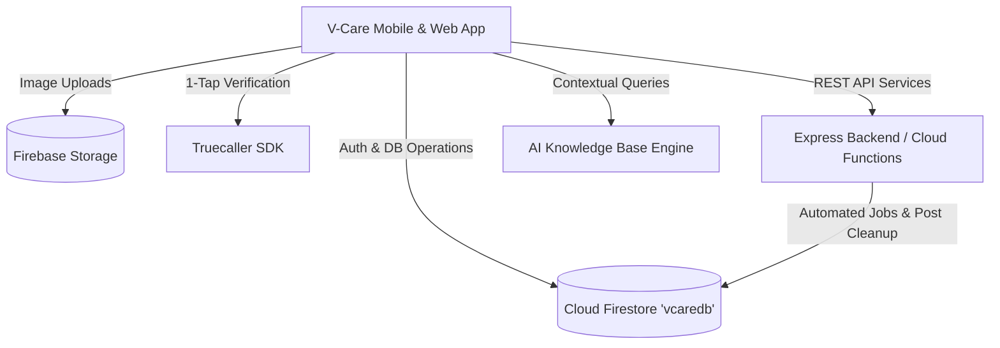

# 🩸 V-Care (VcareBlood)

<div align="center">

[](https://reactnative.dev/)
[](https://expo.dev/)
[](https://firebase.google.com/)
[](https://nodejs.org/)
[](https://expo.dev/)
[](https://opensource.org/licenses/MIT)

**A life-saving, community-driven blood donation and healthcare networking platform connecting donors, recipients, and medical camps in real time.**

[Explore Features](#-key-features) • [Quick Start](#-getting-started) • [Tech Stack](#-tech-stack) • [Architecture](#-architecture) • [Contributing](#-contributing)

</div>

---

## 📌 Overview

**V-Care** is an open-source, full-stack cross-platform mobile and web application designed to bridge the critical gap between voluntary blood donors and patients facing urgent medical emergencies. By combining real-time geo-filtered donor matching, peer-to-peer secure messaging with live typing indicators, an AI-powered blood donation assistant, community emergency feeds with automated lifecycle cleanup, and multilingual regional language support, V-Care ensures that emergency blood requests are addressed swiftly, safely, and reliably.

---

## ✨ Key Features

### 🩸 Real-Time Blood Donor Search & Matching
- Search registered donors instantly filtered by **Blood Group** (A+, A-, B+, B-, AB+, AB-, O+, O-, and Rare Types), **District**, **City**, and **State**.
- Direct one-tap contact capabilities (Direct Phone Call, In-App Chat, and WhatsApp coordination).
- Live donor availability badges (*Available*, *Busy*, *Recently Donated*) with automated cooldown period tracking.

### 💬 Real-Time In-App Messaging
- End-to-end peer-to-peer chat powered by Cloud Firestore.
- Live **typing indicators** (*"typing..."*) synchronized in real time between conversation participants.
- Unread message counters, read receipts, and push notifications.

### 🤖 AI Health & Donation Assistant
- Integrated AI conversational bot trained on comprehensive blood donation and hematology guidelines.
- Answers user inquiries regarding donation eligibility, interval restrictions, dietary preparation, hemoglobin thresholds, and post-donation recovery protocols.

### 📢 Community Emergency Feed
- Create urgent blood requirement appeals and public health announcements with images.
- **Automated 10-Day Lifecycle**: Expired emergency posts and associated storage images are automatically cleaned up to keep the feed fresh and relevant.
- Community engagement with likes, comments, and external social sharing.

### 🔐 Multi-Tier Secure Authentication
- Mobile phone number authentication integrated with Firebase Firestore verification.
- **Truecaller 1-Tap Verification**: Streamlined one-tap onboarding for native Android and seamless web verification fallback.
- Secure visitor mode preventing profile collision or unauthorized session overrides.

### 🌐 Multilingual Localization
- Full localized interface support across **6 languages**:
  - English
  - தமிழ் (Tamil)
  - हिन्दी (Hindi)
  - ಕನ್ನಡ (Kannada)
  - తెలుగు (Telugu)
  - മലയാളം (Malayalam)
- Dynamic runtime language switching without requiring an app reload.

---

## 🛠 Tech Stack

| Domain | Technology |
| :--- | :--- |
| **Mobile Frontend** | React Native `0.72.10`, Expo `~49.0.8` (Managed Workflow) |
| **Styling & UI** | React Native Paper, React Native Vector Icons, React Native Reanimated |
| **Navigation** | React Navigation (Native Stack, Bottom Tabs, Drawer Navigation) |
| **Backend & Cloud** | Firebase Cloud Firestore (`vcaredb`), Firebase Auth, Firebase Cloud Storage |
| **Serverless Functions**| Firebase Cloud Functions (Node.js) |
| **REST API Server** | Node.js, Express.js |
| **Authentication** | Firebase Auth & Truecaller SDK 1-Tap Verification |
| **State & Storage** | React Context API, React Hooks, `@react-native-async-storage/async-storage` |

---

## 🏛 Architecture & Project Structure



### 📁 Directory Layout

```text
vcare-app-0.1/
├── mobile/                   # React Native (Expo) Frontend Application
│   ├── assets/               # Branding assets, icons, logos, and splash screens
│   ├── components/           # Reusable UI components (ChatList, Header, Cards)
│   ├── context/              # Global state (LanguageContext, TabBarContext)
│   ├── firebase/             # Firebase SDK client configurations (mobile & web)
│   ├── screens/              # Core Application Screens
│   │   ├── AboutScreen.js
│   │   ├── AIChatScreen.js
│   │   ├── ChatScreen.js
│   │   ├── DonateAmountScreen.js
│   │   ├── DonorDetailsRegistrationScreen.js
│   │   ├── EditProfileScreen.js
│   │   ├── HomeScreen.js
│   │   ├── NotificationsScreen.js
│   │   ├── PostScreen.js
│   │   ├── ProfileScreen.js
│   │   ├── RegisterScreen.js
│   │   ├── SearchDonorsScreen.js
│   │   └── SettingsScreen.js
│   ├── services/             # API clients, postService, truecallerService, auth
│   ├── app.json              # Expo application configuration
│   └── package.json          # Mobile dependencies & scripts
├── backend/                  # Node.js / Express backend microservice
│   ├── middleware/           # Auth and error handling middleware
│   ├── routes/               # API endpoints
│   ├── server.js             # Express application entry point
│   └── package.json
├── functions/                # Firebase Serverless Cloud Functions
│   ├── index.js              # Scheduled triggers, push notifications, cleanup
│   └── package.json
└── README.md                 # Project Documentation
```

---

## 🚀 Getting Started

### Prerequisites

Ensure you have the following installed on your machine:
- [Node.js](https://nodejs.org/) (`v18.x` or higher)
- [npm](https://www.npmjs.com/) or [yarn](https://yarnpkg.com/)
- [Expo CLI](https://docs.expo.dev/get-started/installation/) (`npm install -g expo-cli`)
- [Git](https://git-scm.com/)

---

### Installation & Local Setup

1. **Clone the repository:**
   ```bash
   git clone https://github.com/MohamedHaarishSherieff/VcareBlood.git
   cd VcareBlood
   ```

2. **Setup and Install Mobile App:**
   ```bash
   cd mobile
   npm install
   ```

3. **Configure Firebase & Environment:**
   Ensure your Firebase credentials are appropriately configured in:
   - `mobile/firebase/config.js`
   - `mobile/firebase/config.web.js`

4. **Launch Development Server:**
   ```bash
   # Run with Expo interactive menu
   npm start

   # Run on Web browser
   npm run web

   # Run on Android emulator / physical device
   npm run android

   # Run on iOS simulator (macOS required)
   npm run ios
   ```

---

## 📱 Core User Flows

1. **Donor Onboarding**:
   Enter mobile number → Verify via 1-Tap Truecaller or standard verification → Fill donor profile (Blood Group, Location, Contact) → Listed immediately on active donor search directory.
2. **Finding Emergency Donors**:
   Select required blood type & location → Review donor availability badges → Directly call or initiate in-app chat.
3. **Posting Community Urgent Needs**:
   Click `+ Post` in community tab → Attach optional blood request photo → Broadcast instantly to all nearby users (auto-expires in 10 days).

---

## 🤝 Contributing

Contributions are what make the open-source community such an amazing place to learn, inspire, and create. Any contributions you make are **greatly appreciated**.

1. Fork the Project
2. Create your Feature Branch (`git checkout -b feature/AmazingFeature`)
3. Commit your Changes (`git commit -m 'Add some AmazingFeature'`)
4. Push to the Branch (`git push origin feature/AmazingFeature`)
5. Open a Pull Request

---

## 📄 License

Distributed under the **MIT License**. See `LICENSE` for more information.

---

## 📬 Contact & Maintainers

- **Lead Developer**: Mohamed Haarish Sherieff
- **GitHub**: [@MohamedHaarishSherieff](https://github.com/MohamedHaarishSherieff)
- **Repository**: [https://github.com/MohamedHaarishSherieff/VcareBlood](https://github.com/MohamedHaarishSherieff/VcareBlood)

<div align="center">
  <sub>Built with ❤️ to save lives through open-source technology.</sub>
</div>
